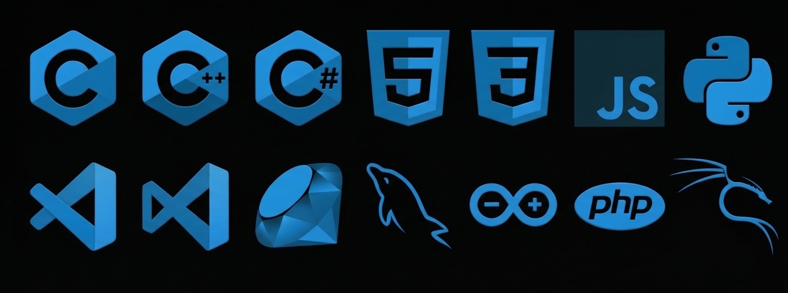

# 👋🏻 Olá, eu sou Antonio!

### 💻 Tecnologia | Desenvolvimento de Software | Segurança da Informação | Inteligência Artificial

*Explorando tecnologias e soluções, desenvolvendo aplicações e aprendendo continuamente...*

---

## 👨🏻‍💻 Sobre mim

Gosto da área de Tecnologia da Informação, tenho formação multidisciplinar e interesse em desenvolvimento de software, segurança da informação, automação e inteligência artificial.

Minha trajetória reúne conhecimentos em programação, desenvolvimento Web e Desktop, automação industrial e microcontroladores. Também possuo experiência com suporte técnico, manutenção de sistemas e desenvolvimento de funcionalidades.

Atualmente, curso Tecnologia da Informação, buscando aprofundar meus conhecimentos e desenvolver soluções tecnológicas inovadoras.

---

## 🛠️ Stack Tecnológica

---

## 🎯 Áreas de interesse

| Área | Foco |
|:---:|:---:|
| 💻 **Desenvolvimento de Software** | Aplicações Web e Desktop |
| 🤖 **Inteligência Artificial** | Sistemas inteligentes e inovação |
| 🔐 **Segurança da Informação** | Proteção de dados e cibersegurança |
| ⚙️ **Automação Industrial** | Sistemas automatizados |
| 🔌 **Sistemas Embarcados** | Arduino e microcontroladores |

---

## 🎓 Formação acadêmica

| Formação |
|:---:|
| 🎓 Tecnologia da Informação — Bacharelado |
| 💻 Análise e Desenvolvimento de Sistemas — Tecnólogo |
| 🤖 Inteligência Artificial — Especialização |
| 🔐 Segurança de Redes e Computadores — Especialização |
| 🛡️ Segurança da Informação — MBA |
| 💻 Desenvolvimento de Sistemas — Técnico |
| ⚙️ Automação Industrial — Técnico |

---

### Aprender sempre!

*Construindo conhecimento, criando soluções.*

